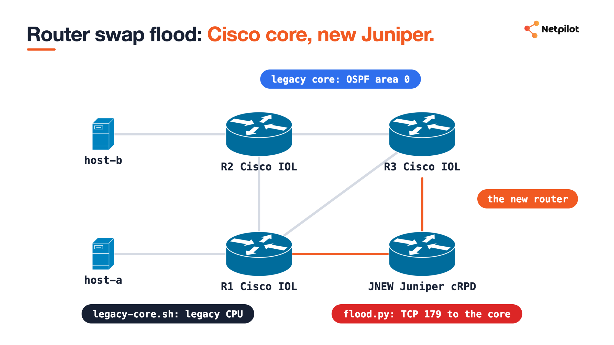

# Router Swap Flood Rehearsal: a New Juniper Router Floods a Legacy Cisco OSPF Core

Recreate the FAA ground stop failure class, a newly installed router flooding legacy equipment, and rehearse the containment before your own cutover window.

## The Prompt

Open it [prefilled in NetPilot](https://app.netpilot.io/?prompt=FAA%20ground%20stop%3A%20officials%20say%20a%20newly%20installed%20router%20flooded%20legacy%20equipment%20with%20more%20than%201%2C000%20connection%20attempts%20every%20few%20seconds.%20Recreate%20it.%20Build%20a%20legacy%20core%20of%20three%20Cisco%20routers%20running%20OSPF%2C%20a%20Linux%20host%20on%20two%20of%20them%2C%20and%20a%20new%20Juniper%20router%20connected%20to%20two%20of%20the%20Cisco%20routers.%20Measure%20the%20OSPF%20neighbors%20and%20ping%20loss%20between%20the%20hosts.%20Before%20the%20flood%2C%20make%20the%20three%20Cisco%20routers%20behave%20like%20legacy%20equipment%3A%20run%20legacy-core.sh%20from%20netpilot-labs%2Fnetwork-labs%20%28multi-vendor%2Frouter-swap-control-plane-flood%29%20on%20the%20lab%20VM.%20Then%20have%20the%20new%20Juniper%20router%20send%20about%20250%20TCP%20connection%20attempts%20a%20second%20to%20the%20Cisco%20routers%20and%20measure%20again.%20Find%20the%20source%2C%20contain%20it%20on%20the%20Cisco%20side%2C%20and%20prove%20the%20network%20recovers%20with%20the%20flood%20still%20running.), or paste it:

> FAA ground stop: officials say a newly installed router flooded legacy equipment with more than 1,000 connection attempts every few seconds. Recreate it. Build a legacy core of three Cisco routers running OSPF, a Linux host on two of them, and a new Juniper router connected to two of the Cisco routers. Measure the OSPF neighbors and ping loss between the hosts. Before the flood, make the three Cisco routers behave like legacy equipment: run legacy-core.sh from netpilot-labs/network-labs (multi-vendor/router-swap-control-plane-flood) on the lab VM. Then have the new Juniper router send about 250 TCP connection attempts a second to the Cisco routers and measure again. Find the source, contain it on the Cisco side, and prove the network recovers with the flood still running.

## What You'll Build

- 3 Cisco IOL routers as the legacy core on OSPF area 0, a Linux host on two of them
- 1 Juniper cRPD router as the new router, linked to two core routers and running OSPF with them
- The legacy-core limit from the lab: a Cisco router busy answering a flood gets almost no CPU, as old equipment would
- A flood from the Juniper router: about 250 TCP connection attempts a second to port 179 on the core's addresses
- Before, during and after numbers: OSPF neighbors and ping loss between the two hosts
- The source named by counters, an inbound filter on the two Cisco interfaces facing the new router, and control plane policing as the backstop

## Concepts Demonstrated

- How a connection flood a modern router shrugs off takes down legacy equipment: OSPF dead timers expire and host traffic stalls
- Naming the source with a counting ACL whose first entry is scoped to one neighbor's link address
- Containing a misbehaving neighbor on your own side of the link with an inbound filter, while OSPF keeps running
- Control plane policing (CoPP) as the backstop behind the filter
- Proving recovery with the fault still running, on the same numbers you measured before the change

## What the Recorded Run Showed

At 250.1 attempts a second from the Juniper router, ping loss between the hosts went from 0 % to 48.5 % and the average round trip from 0.487 ms to about 2,932 ms. R1's adjacency to the Juniper router went down on its dead timer three times, and SSH to two of the Cisco routers timed out. The counting ACL named the Juniper router as the only source (2,894 and 3,010 matches, 0 on the generic entry) about 1 min 20 s after it went on. With the inbound filter on R1 and R3 and the flood still running, the hosts were back to 200 of 200 pings at 0.452 ms and every adjacency FULL. The recorded run applied the same legacy-core limit this prompt asks for: on full-speed images the same flood barely registers. The full numbers are in the lab's README.

## Vendors Used

- Cisco IOL (the legacy core)
- Juniper cRPD (the new router)
- Linux hosts (network-multitool)

## Difficulty

⭐⭐⭐ Advanced

## Variations to Try

- "Run the same flood without legacy-core.sh and compare the ping loss and the OSPF neighbors"
- "Contain the flood at the Juniper side instead, with an output filter on the new router, and compare where it stops"
- "Skip the inbound filter and use only control plane policing on the three Cisco routers, then measure again"
- "Raise the flood to 1,000 attempts a second and find the rate where OSPF drops even with CoPP on"

## Related Resources

- [FAA ground stop: the router swap flood, rebuilt in a lab](https://www.netpilot.io/blog/faa-ground-stop-router-swap-lab): the run, the numbers and a cutover checklist
- Run it yourself: [router-swap-control-plane-flood](https://github.com/netpilot-labs/network-labs/tree/main/multi-vendor/router-swap-control-plane-flood) in network-labs, with legacy-core.sh, the startup configs and the controls
- [Firmware Upgrade Failover Test](firmware-upgrade-failover.md)
- [Change Validation Workflow](change-validation-workflow.md)
- [NetPilot network change validation](https://www.netpilot.io/network-change-validation)
- [Cisco: Control Plane Policing configuration guide](https://www.cisco.com/c/en/us/td/docs/ios-xml/ios/qos_plcshp/configuration/xe-16/qos-plcshp-xe-16-book/qos-plcshp-ctrl-pln-plc.html)

## Try It

[**Open in NetPilot →**](https://app.netpilot.io/?prompt=FAA%20ground%20stop%3A%20officials%20say%20a%20newly%20installed%20router%20flooded%20legacy%20equipment%20with%20more%20than%201%2C000%20connection%20attempts%20every%20few%20seconds.%20Recreate%20it.%20Build%20a%20legacy%20core%20of%20three%20Cisco%20routers%20running%20OSPF%2C%20a%20Linux%20host%20on%20two%20of%20them%2C%20and%20a%20new%20Juniper%20router%20connected%20to%20two%20of%20the%20Cisco%20routers.%20Measure%20the%20OSPF%20neighbors%20and%20ping%20loss%20between%20the%20hosts.%20Before%20the%20flood%2C%20make%20the%20three%20Cisco%20routers%20behave%20like%20legacy%20equipment%3A%20run%20legacy-core.sh%20from%20netpilot-labs%2Fnetwork-labs%20%28multi-vendor%2Frouter-swap-control-plane-flood%29%20on%20the%20lab%20VM.%20Then%20have%20the%20new%20Juniper%20router%20send%20about%20250%20TCP%20connection%20attempts%20a%20second%20to%20the%20Cisco%20routers%20and%20measure%20again.%20Find%20the%20source%2C%20contain%20it%20on%20the%20Cisco%20side%2C%20and%20prove%20the%20network%20recovers%20with%20the%20flood%20still%20running.)
